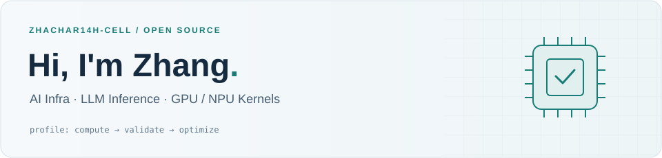

<picture>
  <source media="(prefers-color-scheme: dark)" srcset="assets/header-dark.svg">
  <source media="(prefers-color-scheme: light)" srcset="assets/header-light.svg">
  
</picture>

**Making inference faster, and checking that it stays correct.**

NVIDIA Blackwell / DGX Spark · Ascend · Open Source

[Contributions](#-open-source--pull-requests) · [Project](#-building) · [All pull requests](https://github.com/pulls?q=is%3Apr+author%3Azhachar14h-cell)

 

<table>
<tr>
<td valign="top" width="50%">

### ⚡ Current Focus

- **LLM inference** — serving paths, backend selection and deployment.
- **GPU / NPU kernels** — MoE, low-precision compute and linear attention.
- **Numerical correctness** — reference checks, regression tests and reproducible benchmarks.

</td>
<td valign="top" width="50%">

### 🌱 Open Source

**[FlashQLA contributor](https://github.com/QwenLM/FlashQLA/pull/33)** — merged support for NVIDIA GB10 / SM121 using the SM120 kernels.

Further pull requests span **FlashInfer, SGLang, Atlas, DeepInfer and Strata**, from inference optimizations to hardware compatibility and validation.

</td>
</tr>
</table>

### 🛠 Working With

`Python` · `Rust` · `CUDA` · `TileLang` · `PyTorch` · `Ascend / CANN`

### 🔎 Open Source & Pull Requests

| Project | Selected work | Links |
| :--- | :--- | :--- |
| **[FlashQLA](https://github.com/QwenLM/FlashQLA)** | NVIDIA GB10 / SM121 support | [#33 · Merged](https://github.com/QwenLM/FlashQLA/pull/33) |
| **[FlashInfer](https://github.com/flashinfer-ai/flashinfer)** | Build fingerprints to invalidate stale NVCC JIT caches | [#4490](https://github.com/flashinfer-ai/flashinfer/pull/4490) |
| **[SGLang](https://github.com/sgl-project/sglang)** | FlashInfer CUTLASS backend selection for mixed MoE on SM120 | [#35617](https://github.com/sgl-project/sglang/pull/35617) |
| **[Atlas](https://github.com/Avarok-Cybersecurity/atlas)** | NVFP4 MoE prefill: compact row lists and K32 down projection | [#584](https://github.com/Avarok-Cybersecurity/atlas/pull/584) |
| **[DeepInfer](https://github.com/deepseek-ai/DeepInfer)** | Ascend NUMA discovery and ViT variable-length attention tests | [#129](https://github.com/deepseek-ai/DeepInfer/pull/129) · [#139](https://github.com/deepseek-ai/DeepInfer/pull/139) |
| **[Strata](https://github.com/Niko1221/Strata)** | Ascend MoE validation and compensated S2 rounding | [#3582](https://github.com/Niko1221/Strata/pull/3582) |

Links point to upstream pull requests, where review status, measurements and validation scope are recorded.

### 🚀 Building

**[Uniform DGX Spark — Claude Code Plugin](https://github.com/zhachar14h-cell/uniform-dgxspark-claude-plugin)**

A Claude Code client for a running Uniform DGX Spark platform: deploy models, follow progress, inspect logs and monitor machine metrics from a coding session.

`TypeScript` · `Claude Code` · `DGX Spark` · `Model Deployment`

---

  From kernel behavior to serving behavior — measure, verify, improve.

